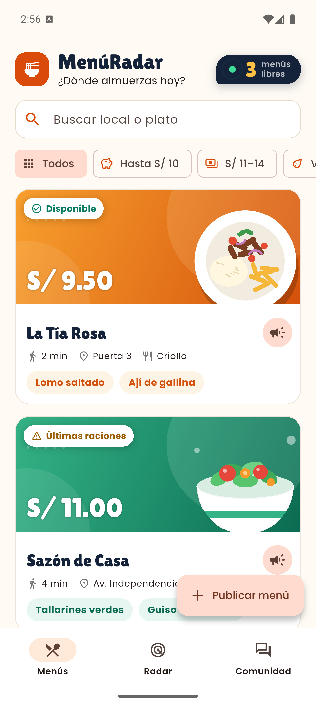
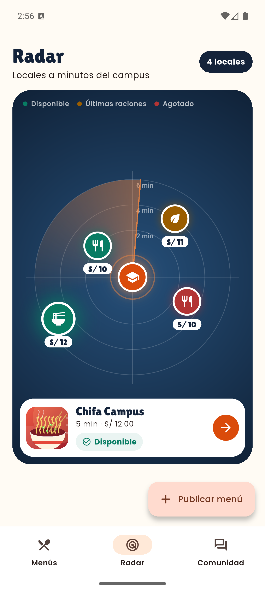
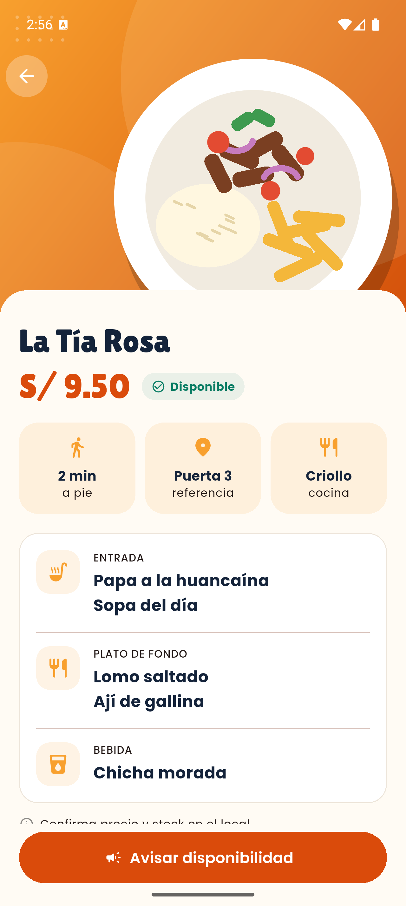
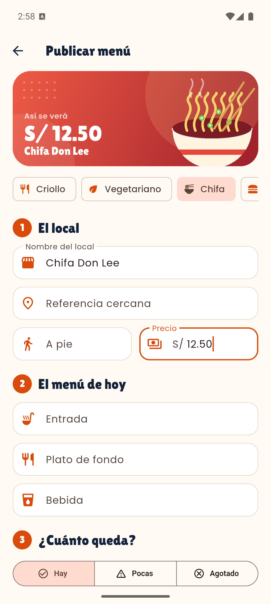

# MenúRadar

Aplicación móvil para encontrar **menús económicos y disponibles cerca del campus** antes de salir al receso. Compara precios, consulta qué queda en cada local y avisa a otros estudiantes cuando algo se agota. Está hecha con Flutter, sin paquetes externos, y pensada sobre todo para Android.

| Menús | Radar | Comunidad |
|:---:|:---:|:---:|
|  |  |  |

| Detalle | Publicar |
|:---:|:---:|
|  |  |

## Qué hace

- **Menús:** lista con búsqueda y filtros por precio o cocina. Cada tarjeta muestra el precio, el estado de disponibilidad y los platos de un vistazo.
- **Detalle:** entrada, plato de fondo y bebida, con los minutos a pie y la referencia del local.
- **Radar:** los locales se ubican a una distancia proporcional a sus minutos a pie. Al tocar un pin aparece una vista previa del local.
- **Comunidad:** avisos recientes de otros estudiantes. Se publica sin cuenta, con un apodo que se pide la primera vez.
- **Publicar menú:** formulario con íconos, secciones y una vista previa en vivo de cómo se verá el menú.
- **Avisar disponibilidad:** hoja inferior para marcar un menú como disponible, con últimas raciones o agotado. El cambio se refleja en la lista, el radar y Comunidad.

> Los locales y avisos iniciales son datos de ejemplo. Los cambios viven en memoria mientras la app está abierta: no hay base de datos, GPS ni sincronización entre dispositivos. El radar es una visualización referencial, no un mapa.

## Tecnologías

- **Flutter 3.47** y **Dart 3.13**, con Material 3.
- Sin dependencias de ejecución: solo el SDK.
- Ilustraciones de los platos dibujadas con `CustomPainter`, sin imágenes externas.
- Tipografías **Lilita One** (titulares) y **Poppins** (texto), incluidas en `assets/fonts/` bajo licencia SIL OFL.
- Estado compartido con `ChangeNotifier` (`MenuStore`).

## Ejecutar

Requisitos: Flutter 3.47 o superior y un emulador Android (o Chrome para una prueba rápida).

```powershell
flutter pub get
flutter emulators --launch <id-del-emulador>
flutter run
```

- `flutter run -d chrome` abre la app en el navegador, sin emulador.
- Durante `flutter run`, `r` recarga el código y `R` reinicia la app.
- El APK de depuración pesa unos 140 MB: el emulador necesita al menos 4 GB libres en su partición de datos.

Comprobaciones:

```powershell
flutter analyze
flutter test
```

## Estructura

```text
lib/
  main.dart                       Arranque y tema
  theme/app_theme.dart            Colores, tipografías y ThemeData
  models/menu.dart                Menú, estados de disponibilidad y avisos
  data/menu_store.dart            Estado en memoria (ChangeNotifier)
  screens/
    home_shell.dart               Scaffold, NavigationBar y botón flotante
    explore_tab.dart              Menús: búsqueda, filtros y lista
    radar_tab.dart                Radar animado con pines y vista previa
    community_tab.dart            Comunidad: cabecera y burbujas
    menu_detail_page.dart         Detalle con SliverAppBar
    publish_menu_page.dart        Formulario con vista previa
  widgets/
    food_art.dart                 Ilustraciones de platos y banner por cocina
    menu_card.dart                Tarjeta de menú
    status_badge.dart             Indicador de disponibilidad
    availability_sheet.dart       Hoja para avisar disponibilidad
    notice_composer.dart          Hoja para publicar un aviso
assets/fonts/                     Lilita One y Poppins
screenshots/                      Capturas usadas en este README
test/                             Prueba de widget
```

## Decisiones de diseño

- **Un solo estado compartido.** Avisar disponibilidad, publicar un menú y publicar un aviso escriben en `MenuStore`. Las tres pestañas lo escuchan, así que un cambio se ve de inmediato en todas.
- **Comunidad sin cuentas.** Publicar con un apodo de sesión mantiene el primer aviso a segundos de distancia. Una versión con servidor usaría el correo institucional.
- **Ilustraciones vectoriales.** Dibujar los platos con `CustomPainter` evita depender de fotos con licencia y permite reutilizarlos en tarjetas, cabeceras y miniaturas.
- **Radar con significado.** La distancia al centro equivale a los minutos a pie, y los anillos usan la misma fórmula que los pines (`radarFraction`).

## Próximos pasos

- Guardar menús y avisos en un servidor para compartirlos entre dispositivos.
- Cuentas con correo institucional para verificar a quien publica.
- Ubicación real de los locales en lugar de posiciones ilustrativas.
- Cambiar el identificador `com.example.menu_radar` por uno propio antes de publicar.
