# Análisis del problema, diseño de interfaces y layout

## 1. Árbol de problemas

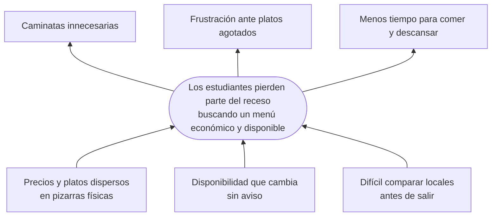

| Causas | Problema central | Efectos |
|---|---|---|
| Información dispersa en pizarras físicas. Disponibilidad cambiante sin aviso. Poca posibilidad de comparar antes de salir. | Tiempo perdido al buscar un menú cercano, económico y disponible. | Caminatas innecesarias. Frustración al encontrar platos agotados. Menos tiempo para comer y descansar. |

El árbol parte de la descripción del trabajo previo MenúRadar (PWA con React). Las cifras de ahorro de tiempo de ese documento no se midieron en este prototipo.

## 2. Del problema a la interfaz

| Causa que ataca | Funcionalidad | Pantalla | Widgets principales |
|---|---|---|---|
| Información dispersa | Buscar y filtrar menús | Menús | `TextField`, `FilterChip`, `ListView`, `Card` |
| Información dispersa | Consultar platos, precio y referencia | Detalle | `CustomScrollView`, `SliverAppBar`, `Card` |
| Disponibilidad sin aviso | Ver y reportar disponibilidad | Tarjeta, detalle, hoja inferior | `StatusBadge`, `showModalBottomSheet`, `ListTile` |
| Disponibilidad sin aviso | Leer avisos recientes | Comunidad | `ListView`, `ClipPath`, `Transform.rotate` |
| Difícil comparar | Ver qué tan lejos está cada local | Radar | `LayoutBuilder`, `Stack`, `Positioned`, `CustomPaint` |
| Información dispersa | Publicar un menú | Publicar | `Form`, `TextFormField`, `DropdownButtonFormField`, `SegmentedButton` |

## 3. Diseño de cada pantalla

### 3.1 Menús

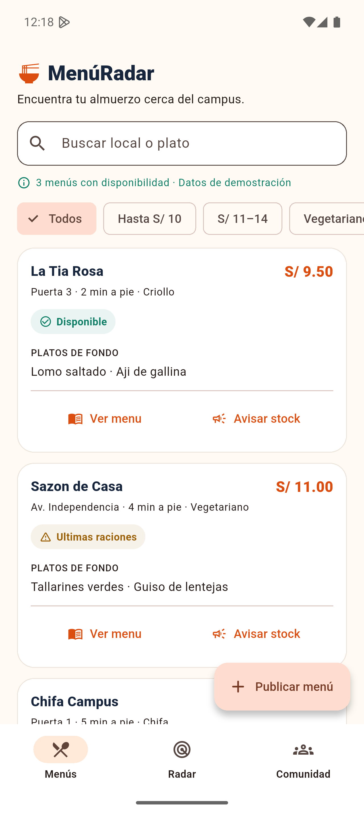

- **Encabezado:** `Row` con logo, título en Lilita One y un indicador de menús libres: punto verde que late como un eco de radar junto al número, sobre una cápsula azul oscuro de esquina irregular (`CustomPainter` + `AnimationController`).
- **Búsqueda y filtros:** `TextField` y una `ListView` horizontal de `FilterChip` con ícono.
- **Tarjeta:** el banner con la ilustración ocupa la parte alta; el precio y el estado van sobre la imagen. Debajo: nombre, tres datos con ícono y los platos como chips tintados con el color de la cocina.
- **Menú agotado:** la imagen se oscurece y aparece el sello "AGOTADO" (ver [captura](capturas/01c_agotado.png)).

```text
Scaffold
└─ SafeArea
   └─ IndexedStack
      └─ ExploreTab · Column
         ├─ Row (logo, título, pill de libres)
         ├─ TextField
         ├─ ListView horizontal · FilterChip
         └─ Expanded
            └─ ListView.separated
               └─ MenuCard · Card
                  └─ InkWell · Column
                     ├─ Stack (Hero > FoodBanner, StatusBadge, precio)
                     └─ Padding (nombre, Wrap de datos, Wrap de chips)
```

### 3.2 Detalle

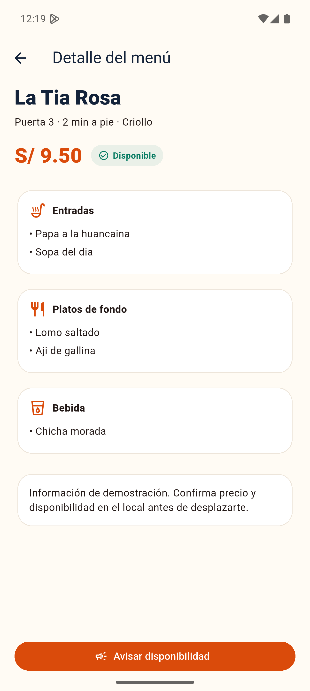

- **Cabecera:** `SliverAppBar` que se colapsa al desplazar. La ilustración viaja desde la tarjeta con un `Hero`.
- **Datos clave:** tres fichas en `Row` con `Expanded` (minutos a pie, referencia, cocina).
- **Menú del día:** una sola `Card` con tres filas (entrada, plato de fondo, bebida), cada una con un ícono tintado.
- **Acción:** botón fijo en `bottomNavigationBar` para avisar disponibilidad.

### 3.3 Radar

| Sin selección | Con un local seleccionado |
|:---:|:---:|
| 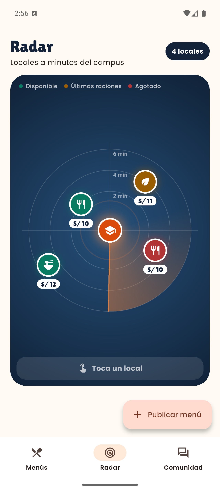 |  |

- **Fondo:** `CustomPaint` con degradado radial, tres anillos rotulados en minutos (2, 4 y 6), ejes y un barrido animado con `SweepGradient` movido por un `AnimationController`.
- **Distancia con significado:** cada pin se coloca a una distancia proporcional a sus minutos a pie. El ángulo viene de la posición ilustrativa del menú. Se deja un radio mínimo para no tapar el marcador del campus.
- **Pines:** círculo del color del estado con el ícono de la cocina y el precio debajo. El seleccionado crece y brilla (`AnimatedScale`).
- **Vista previa:** al tocar un pin aparece una tarjeta con la imagen del plato, que cambia con `AnimatedSwitcher`.

### 3.4 Comunidad

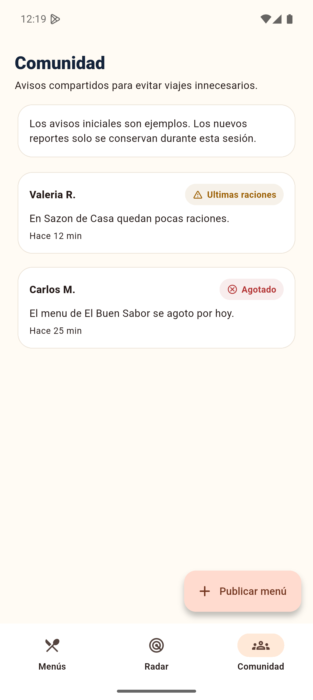

- **Cabecera:** `ClipPath` con un `CustomClipper` que recorta una onda, círculos translúcidos, una ilustración girada con `Transform.rotate` y un sticker amarillo inclinado.
- **Burbujas:** alternan lado izquierdo y derecho. La esquina inferior del lado del avatar es casi recta, lo que da forma de globo de conversación.
- **Imágenes:** una miniatura circular del plato (`ClipOval`) y un avatar con la inicial del autor y un ícono de estado.

#### Cómo se publica un aviso

Se evaluaron tres formas de identificar a quien publica:

| Opción | Ventaja | Inconveniente | Decisión |
|---|---|---|---|
| Cuenta con correo institucional | Autores verificables | Exige servidor y registro; frena el primer aviso | Para una versión real |
| **Apodo local, sin cuenta** | Publicar en segundos; no requiere servidor | No hay verificación | **Usada en el prototipo** |
| Anónimo total | Cero fricción | Los avisos no tienen quién los respalde | Descartada |

La primera vez que alguien publica, la hoja **Nuevo aviso** pide un apodo (2 a 16 caracteres) y lo recuerda mientras la app está abierta. Después solo pide tres datos: dónde, cómo está y un comentario opcional. El encabezado pasa a decir "Publicas como …".

| Sin apodo | Con el aviso completo | Resultado |
|:---:|:---:|:---:|
| 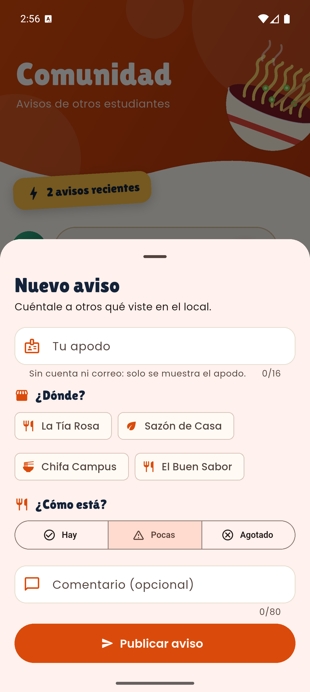 | 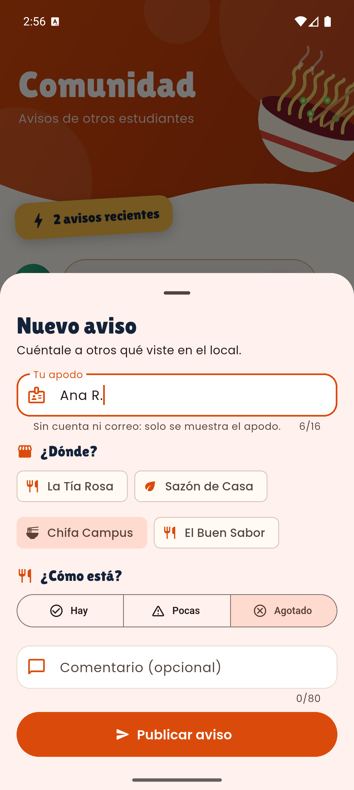 | 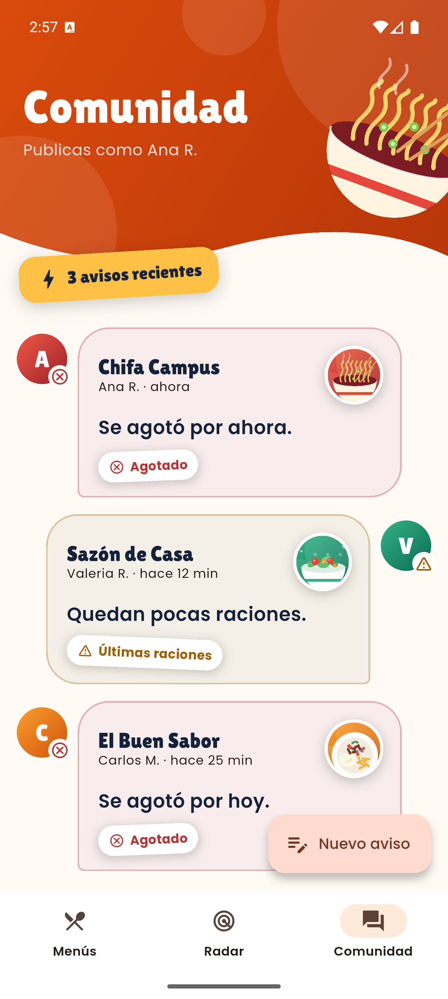 |

El botón flotante cambia a **Nuevo aviso** en esta pestaña. Publicar un aviso también actualiza el estado del menú elegido, de modo que la lista y el radar reflejan lo que reportó la comunidad.

### 3.5 Publicar

| Formulario | Vista previa en vivo |
|:---:|:---:|
| 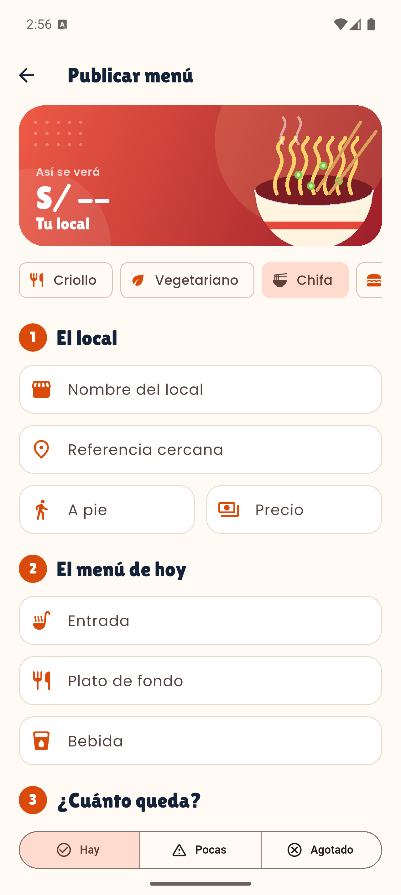 |  |

El formulario se organiza para que no parezca largo:
- **Vista previa arriba:** un banner que muestra cómo se verá el menú. Cambia en vivo al elegir la cocina y al escribir el nombre y el precio (`ListenableBuilder` sobre los controladores).
- **Cocina en chips:** `ChoiceChip` con ícono dentro de una `ListView` horizontal; reemplazan al menú desplegable.
- **Tres secciones numeradas:** *El local*, *El menú de hoy* y *¿Cuánto queda?*, cada una con título en Lilita One.
- **Un ícono por campo:** `prefixIcon` en color de marca, con ejemplos como `hintText`.
- **Validación amable:** cada campo se valida solo cuando se interactúa con él (`AutovalidateMode.onUserInteraction` por campo). El formulario completo se valida al pulsar *Publicar menú*.
- **Disponibilidad:** `SegmentedButton` a todo el ancho con íconos.

## 4. Widgets de organización y layout investigados

| Widget | Función | Dónde se usa |
|---|---|---|
| `MaterialApp`, `ThemeData` | Raíz, navegación y tema Material 3. | `main.dart`, `app_theme.dart` |
| `Scaffold` | Estructura con cuerpo, navegación y botón flotante. | Todas las pantallas |
| `SafeArea` | Evita barras y recortes del sistema. | Shell y detalle |
| `Column`, `Row` | Ordenan en vertical y horizontal. | Encabezados, tarjetas, fichas |
| `Expanded` | Reparte el espacio libre. | Lista, panel del radar, fichas |
| `Padding`, `SizedBox` | Márgenes y separaciones. | Toda la app |
| `Wrap` | Pasa a otra línea si falta ancho. | Datos y chips de la tarjeta, leyenda |
| `ListView` | Contenido desplazable. | Menús, Comunidad, formulario |
| `CustomScrollView`, `SliverAppBar` | Cabecera que se colapsa con el scroll. | Detalle |
| `Stack`, `Positioned` | Superponen elementos y los ubican. | Banner de la tarjeta, radar, cabecera |
| `LayoutBuilder` | Adapta posiciones al espacio recibido. | Radar y banner |
| `IndexedStack` | Mantiene vivas las pestañas. | Shell |
| `NavigationBar` | Navegación principal. | Shell |
| `Hero` | Transición compartida entre pantallas. | Tarjeta a detalle |
| `ClipRRect`, `ClipOval`, `ClipPath` | Recortan en formas. | Banner, miniaturas, onda |
| `Transform.rotate` | Gira un widget. | Sellos y sticker |
| `CustomPaint`, `CustomPainter` | Dibujo propio en un lienzo. | Ilustraciones y radar |
| `AnimatedSwitcher`, `AnimatedScale` | Animaciones implícitas. | Vista previa y pines |
| `AnimationController` | Animación continua (barrido y eco). | Radar e indicador de libres |
| `ChoiceChip`, `FilterChip` | Elección de una opción con chips. | Cocina, filtros y local del aviso |
| `ListenableBuilder` | Reconstruye al cambiar un controlador. | Vista previa del formulario |
| `showModalBottomSheet` | Hoja inferior modal. | Avisar stock y Nuevo aviso |

**Reglas de layout aplicadas**
- Las listas reciben altura acotada con `Expanded`.
- El contenido largo se desplaza; los chips usan `Wrap` o scroll horizontal.
- El radar usa medidas relativas al espacio disponible, no coordenadas fijas.
- El contenido deja 100 px libres al final para que el botón flotante no tape el último elemento.

## 5. Tipografía

Dos familias incluidas en `assets/fonts/`, ambas con licencia SIL Open Font License, de modo que la app no depende de internet:

| Familia | Uso | Por qué |
|---|---|---|
| **Lilita One** | Títulos, precios, nombres de local y sellos | Trazo grueso y redondeado que recuerda a un letrero de comida; da identidad con pocas palabras. Tiene un solo peso, así que nunca se le aplica negrita. |
| **Poppins** (Regular, Medium, SemiBold, Bold) | Texto de lectura, etiquetas y botones | Geométrica y muy legible en pantallas pequeñas. |

En el código, `ThemeData(fontFamily: 'Poppins')` fija la base y `AppText.display()` entrega el estilo de titular. Los estilos de títulos del tema (`headlineMedium`, `headlineSmall`, `titleLarge`) ya usan Lilita One.

## 6. Ilustraciones sin imágenes externas

Los platos se dibujan con `CustomPainter` en un lienzo normalizado de 0 a 1 (`lib/widgets/food_art.dart`). Hay una ilustración por cocina: plato criollo, bowl vegetariano, bowl de chifa y una cloche genérica. Ventajas: no pesan, escalan sin perder calidad y no dependen de licencias. Se pueden reemplazar por fotos reales con `Image.asset` sin cambiar el resto del diseño.

## 7. Flujo de navegación

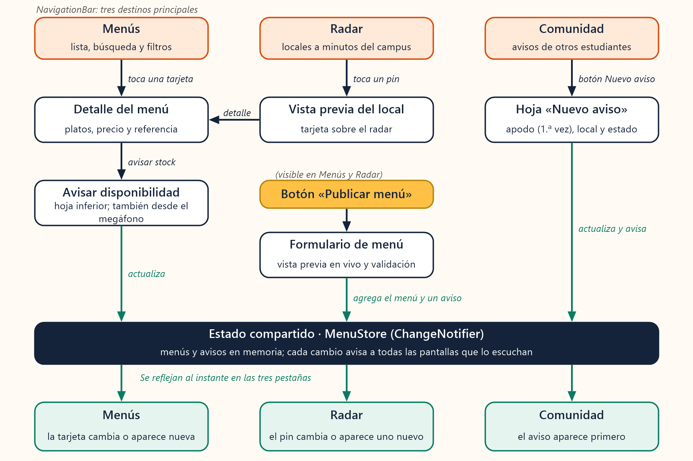

El mismo flujo en forma de diagrama editable:

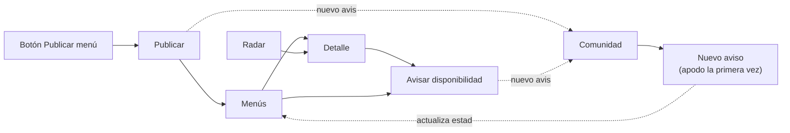

## 8. Fuentes técnicas

- Flutter, [Layouts in Flutter](https://docs.flutter.dev/ui/layout).
- Flutter, [Layout widgets](https://docs.flutter.dev/ui/widgets/layout).
- Flutter, [Understanding constraints](https://docs.flutter.dev/ui/layout/constraints).
- Flutter, [Material components](https://docs.flutter.dev/ui/widgets/material).
- Flutter, [CustomPaint](https://api.flutter.dev/flutter/widgets/CustomPaint-class.html) y [Hero animations](https://docs.flutter.dev/ui/animations/hero-animations).
- Flutter, [Use a custom font](https://docs.flutter.dev/cookbook/design/fonts) y [Forms](https://docs.flutter.dev/cookbook/forms/validation).
- Google Fonts, [Lilita One](https://fonts.google.com/specimen/Lilita+One) y [Poppins](https://fonts.google.com/specimen/Poppins) (SIL Open Font License 1.1).

Documento temático de referencia: *MenúRadar: Aplicativo Móvil Universitario para la Gestión en Tiempo Real de Menús Estudiantiles* (PDF previo del equipo).
